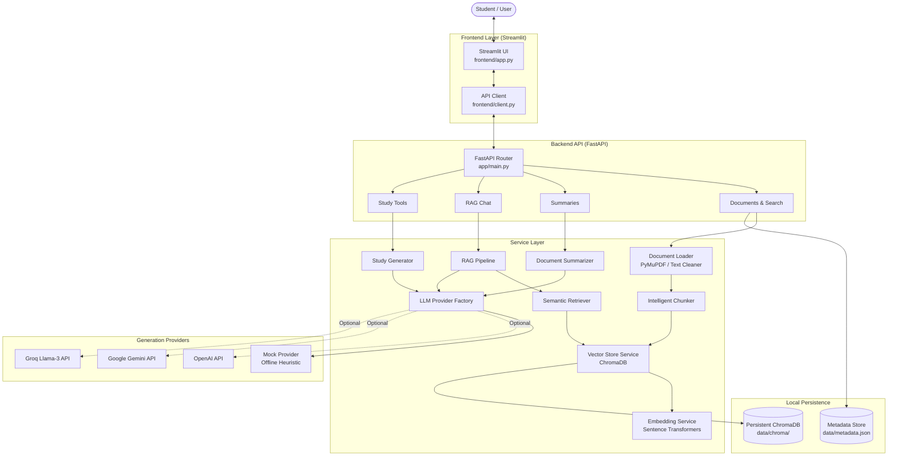

# Notely — AI-Powered RAG Study Assistant

> **Tagline:** *Your notes. Smarter.*

Notely is an end-to-end, local-first Retrieval-Augmented Generation (RAG) study platform designed for university students, researchers, and learners. It transforms lecture slides, textbook chapters, PDFs, and raw notes into structured, searchable, and interactive revision material.

---

## Key Features

- **Document Ingestion & Extraction**:
  - Multi-page PDF text extraction with page provenance tracking using PyMuPDF.
  - Plain text file (`.txt`) ingestion and direct text-pasting interface.
  - Whitespace and hyphenation normalization preserving paragraph structure and lists.
  - Automatic detection of scanned or textless PDFs with clear OCR requirements.
  - Content SHA-256 deduplication to prevent accidental re-ingestion.

- **Intelligent Chunking Engine**:
  - Sliding-window paragraph- and sentence-aware chunking.
  - Configurable target chunk size (characters) and overlap with parameter validation.
  - Deterministic chunk identifiers (`<doc_id>_chunk_<index>`) and metadata attachments.
  - Interactive **Chunk Explorer** interface for inspecting chunk boundaries and re-indexing.

- **Local Semantic Retrieval**:
  - Dense text embeddings computed locally using Sentence Transformers (`all-MiniLM-L6-v2`).
  - Persistent vector storage and cosine similarity search powered by ChromaDB.
  - Document-scoped filtering for targeted study sessions.

- **Extractive & AI Summarization**:
  - **Extractive Mode (Offline)**: Term-frequency salience algorithm selecting representative sentences without external API calls.
  - **AI Generation Modes**: Executive short summaries, comprehensive outlines, section breakdowns, key bullet points, and exam revision guides.
  - Hierarchical map-reduce summarization for large multi-page texts.

- **Evidence-Grounded RAG Question Answering**:
  - Answers strictly constrained to retrieved evidence passages.
  - Verified source citations including document title, page number, and similarity score.
  - Transparent messaging and fallback when evidence is insufficient.
  - Untrusted prompt isolation protecting against prompt injection embedded in notes.

- **Interactive Study Tools**:
  - **Interactive Flashcards**: Flip/reveal mechanism, previous/next navigation, known vs. needs revision tracking, and progress metrics.
  - **Multiple-Choice Quizzes**: Grounded questions with plausible distractors, immediate scoring, and source-cited explanations.
  - **Structured Revision Sheets**: Definitions, fundamental concepts, governing formulas/rules, comparisons, and likely exam questions.

- **Modular Provider Abstraction**:
  - **Mock / Local Demo Provider**: Generates synthesized study materials locally without paid API access (clearly labeled in UI).
  - External LLM support for **OpenAI**, **Google Gemini**, and **Groq** via environment variables.

---

## Architecture Overview



---

## How the RAG Pipeline Works

1. **Ingestion**: When a PDF or note is uploaded, PyMuPDF extracts raw text page-by-page. The text cleaner normalizes irregular whitespace and hyphenated line breaks.
2. **Chunking**: The document is partitioned into semantic segments based on paragraph boundaries, sentences, and configured character limits (default: 500 characters, 100 character overlap).
3. **Indexing**: Each chunk text is passed through the `all-MiniLM-L6-v2` Sentence Transformer model to produce a normalized 384-dimensional dense vector, stored with metadata in ChromaDB.
4. **Retrieval**: When a student asks a question, the query string is converted to an embedding and compared against indexed vectors using cosine similarity. The top-k closest chunks are retrieved.
5. **Generation**: The retrieved passages are formatted as separate, untrusted evidence blocks alongside the student query. The active LLM provider synthesizes an answer referencing the specific document name and page number. If the query does not match the retrieved excerpts, Notely states that the notes lack sufficient evidence.

---

## Repository Structure

```
Notely/
├── app/
│   ├── __init__.py
│   ├── config.py                 # Pydantic Settings & environment config
│   ├── main.py                   # FastAPI application & route registration
│   ├── schemas.py                # Pydantic request/response schemas
│   ├── api/
│   │   ├── __init__.py
│   │   └── routes/
│   │       ├── __init__.py
│   │       ├── health.py         # System health & telemetry
│   │       ├── documents.py      # Upload, paste, search, chunk explorer
│   │       ├── summaries.py      # Extractive and AI summarization
│   │       ├── chat.py           # RAG Q&A endpoint
│   │       └── study.py          # Flashcards, quizzes, revision notes
│   ├── core/
│   │   ├── __init__.py
│   │   ├── exceptions.py         # Custom application exception hierarchy
│   │   └── logging.py            # Privacy-conscious logging
│   ├── models/
│   │   ├── __init__.py
│   │   ├── chunk.py              # DocumentChunk model
│   │   └── document.py           # Document and DocumentPage models
│   └── services/
│       ├── __init__.py
│       ├── chunker.py            # Paragraph/sentence sliding-window chunking
│       ├── document_loader.py    # PyMuPDF extraction, TXT, OCR detection, text cleaner
│       ├── document_store.py     # Thread-safe persistent JSON metadata store
│       ├── embeddings.py         # SentenceTransformer lazy loader
│       ├── llm_provider.py       # Mock, OpenAI, Gemini, Groq providers
│       ├── metrics.py            # Real-time application metrics
│       ├── rag_pipeline.py       # Grounded RAG orchestrator
│       ├── retriever.py          # Semantic similarity retrieval
│       ├── study_generator.py    # Flashcard, quiz, revision generators
│       ├── summarizer.py         # Extractive TF salience & AI summaries
│       └── vector_store.py       # ChromaDB client & vector operations
├── frontend/
│   ├── __init__.py
│   ├── app.py                    # Streamlit interactive web application
│   ├── client.py                 # API client with direct service fallback
│   └── styles.py                 # Indigo-accented custom styling
├── tests/
│   ├── conftest.py               # In-memory vector store & PDF generator fixtures
│   ├── test_api.py               # End-to-end API integration tests
│   ├── test_chunker.py           # Chunk bounds, overlap, and ID tests
│   ├── test_document_loader.py   # PDF, TXT, OCR detection, corrupt docs
│   ├── test_embeddings.py        # Embedding dimensions and L2 normalization
│   ├── test_health.py            # Health check endpoint test
│   ├── test_rag_pipeline.py      # RAG answer, citation, insufficient evidence
│   ├── test_retriever.py         # Semantic search, doc filters, deletion
│   ├── test_study_generator.py   # Flashcards, MCQ quiz, revision notes
│   └── test_summarizer.py        # Extractive & AI summarization tests
├── data/
│   └── .gitkeep                  # Local data storage directory
├── .env.example                  # Environment configuration template
├── .gitignore                    # Excludes persistent data, venv, and cache
├── pyproject.toml                # Project metadata, ruff, and pytest config
├── requirements.txt              # Production and test dependencies
└── README.md                     # Documentation
```

---

## Installation & Setup

### Prerequisites
- Python 3.10+ (tested on Python 3.10, 3.11, 3.12, 3.13, 3.14)
- Git

### 1. Clone & Navigate to Repository
```bash
git clone https://github.com/Zuhairsyed123/Notely.git
cd Notely
```

### 2. Create and Activate Virtual Environment

**Windows (PowerShell):**
```powershell
python -m venv .venv
.\.venv\Scripts\Activate.ps1
```

**macOS / Linux:**
```bash
python3 -m venv .venv
source .venv/bin/activate
```

### 3. Install Dependencies
```bash
pip install -r requirements.txt
```

> **Note on Local Embeddings:** The first time embeddings are computed, Sentence Transformers automatically downloads the `all-MiniLM-L6-v2` model weights (~90 MB) to your local cache. Subsequent runs use the cached weights offline.

---

## Configuration

Copy `.env.example` to `.env`:
```powershell
cp .env.example .env
```

### Available Environment Variables

| Variable | Default | Description |
|---|---|---|
| `BACKEND_HOST` | `127.0.0.1` | FastAPI server host |
| `BACKEND_PORT` | `8000` | FastAPI server port |
| `API_BASE_URL` | `http://127.0.0.1:8000` | API base URL for Streamlit client |
| `NOTELY_DATA_DIR` | `data` | Local directory for persistent metadata |
| `NOTELY_CHROMA_DIR` | `data/chroma` | Persistent ChromaDB storage path |
| `NOTELY_EMBEDDING_MODEL` | `all-MiniLM-L6-v2` | Local Sentence Transformer model |
| `NOTELY_DEFAULT_CHUNK_SIZE` | `500` | Default character count per chunk |
| `NOTELY_DEFAULT_CHUNK_OVERLAP` | `100` | Default overlap between consecutive chunks |
| `NOTELY_DEFAULT_TOP_K` | `4` | Default number of evidence chunks retrieved |
| `NOTELY_LLM_PROVIDER` | `mock` | Generation provider: `mock`, `openai`, `gemini`, or `groq` |
| `OPENAI_API_KEY` | *(empty)* | Required only if `NOTELY_LLM_PROVIDER=openai` |
| `OPENAI_MODEL` | `gpt-4o-mini` | OpenAI chat completion model name |
| `GEMINI_API_KEY` | *(empty)* | Required only if `NOTELY_LLM_PROVIDER=gemini` |
| `GEMINI_MODEL` | `gemini-1.5-flash` | Google Gemini model name |
| `GROQ_API_KEY` | *(empty)* | Required only if `NOTELY_LLM_PROVIDER=groq` |
| `GROQ_MODEL` | `llama-3.1-8b-instant` | Groq model name |

### Mock Mode vs. Real Generation
- **Mock Mode (`NOTELY_LLM_PROVIDER=mock`)**: Default mode. Runs 100% offline without any paid API keys. Answers and study materials are synthesized directly from retrieved passages using deterministic heuristics. Clearly labeled as mock in the interface.
- **External Providers**: When configured with valid API keys for OpenAI, Gemini, or Groq, Notely sends only the retrieved evidence excerpts relevant to the user's specific query. Documents are never transmitted to third parties unless an external provider is explicitly configured.

---

## Running the Application

### Option A: Run Both Services Concurrently (Recommended)

**Terminal 1 — Backend API:**
```powershell
python -m uvicorn app.main:app --host 127.0.0.1 --port 8000 --reload
```
Interactive API documentation will be available at: `http://127.0.0.1:8000/docs`

**Terminal 2 — Streamlit Frontend:**
```powershell
python -m streamlit run frontend/app.py --server.port 8501
```
The Streamlit interface will open in your browser at: `http://127.0.0.1:8501`

### Option B: Standalone Frontend
If you run only the Streamlit frontend without starting the separate FastAPI server:
```powershell
python -m streamlit run frontend/app.py
```
Notely's client automatically detects that the HTTP server is offline and switches to direct service-layer execution. All functionality remains 100% operational.

---

## Running Automated Tests

Run the full automated test suite:
```powershell
python -m pytest -v
```

All 28 tests execute in isolation using in-memory ephemeral vector collections and temporary files:
- **`test_health.py`**: Health check schema and status codes.
- **`test_document_loader.py`**: PDF extraction, TXT decoding, OCR detection for scanned PDFs, corrupted file handling, and SHA-256 deduplication.
- **`test_chunker.py`**: Character bounds, overlap validation, long paragraph splits, and deterministic IDs.
- **`test_embeddings.py`**: Vector dimensions, L2 normalization, and empty query validation.
- **`test_retriever.py`**: Cosine similarity ranking, document filtering, and vector purging.
- **`test_summarizer.py`**: Extractive frequency salience and AI summarization modes.
- **`test_rag_pipeline.py`**: Grounded citations, source excerpts, and insufficient evidence handling.
- **`test_study_generator.py`**: Flashcard generation, MCQ quiz schemas with 4 options, and revision sheets.
- **`test_api.py`**: End-to-end FastAPI endpoint integration tests.

Run linting:
```powershell
ruff check .
```

---

## Example Walkthrough

1. **Upload or Paste**: Open `http://127.0.0.1:8501` and navigate to **My Documents**. In the *Paste Text Notes* tab, enter a title like `Biology: Cellular Respiration` and paste your lecture notes. Click **Save & Index Notes**.
2. **Inspect Chunks**: Go to **Chunk Explorer**. Adjust the target chunk size (e.g., 300 characters) and overlap (e.g., 50 characters). Click **Inspect Chunks** to view the exact text segments indexed in ChromaDB.
3. **Summarize**: Go to **Summarize**. Select your notes and choose *Extractive Summary* or *AI Key Takeaways*.
4. **Chat**: Go to **Chat with Notes**. Ask a targeted question like: *"What is the governing equation for cellular respiration?"*. View the generated answer and expand the **Verified Source Citations** to see exact page references and relevance scores.
5. **Study**: Go to **Study Tools**:
   - Flip through interactive **Flashcards** and mark cards as *Known* or *Needs Revision*.
   - Take an interactive **MCQ Quiz**, select options, and view your score alongside source-backed explanations.
   - Generate a **Course Revision Guide** detailing vocabulary, concepts, formulas, and potential exam questions.

---

## Known Limitations

1. **Scanned Images in PDFs**: Pure scanned PDFs (images without an OCR text layer) cannot be parsed directly by PyMuPDF. Notely detects these documents and presents an informative warning explaining that OCR pre-processing is required.
2. **Single-User Architecture**: Notely is designed as a local-first study assistant. It uses local thread-safe JSON metadata and ChromaDB persistence without authentication or multi-tenant user isolation.
3. **Local Embedding Latency**: Computing embeddings for very large documents (hundreds of pages) on CPU-only machines may take several seconds.

---

## Future Improvements

- Tesseract or Apple Vision OCR integration for direct scanned image PDF extraction.
- Cross-encoder re-ranking (e.g. `bge-reranker`) to further refine top-k retrieval precision.
- Anki deck export (`.apkg`) for generated flashcards.
- Audio note ingestion with Whisper speech-to-text.
- Multi-document comparative study matrices.
